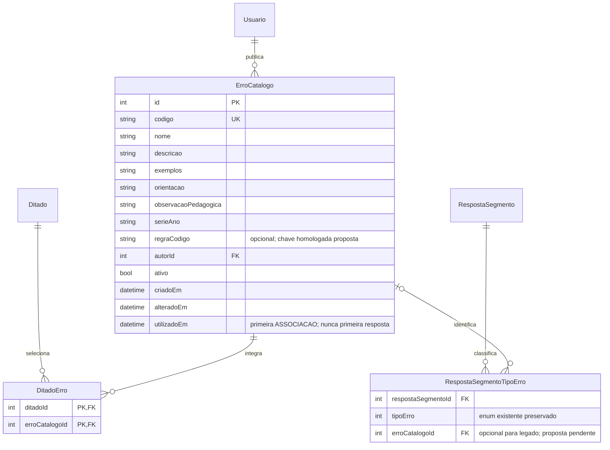

# Marketplace — ER proposto, CAT-09

Revisão pendente; [contrato e decisões](../../epicos/catalogo-contrato.md). Não representa schema implementado.

Regra executável fica no domínio, sem tabela/editor de código livre. Conforme parecer final do gerente, cada erro programado possui item preparado no Marketplace com vínculo interno ao executor existente; professor seleciona itens e novos cadastros docentes não recebem executor. Q2/Q3 foram retiradas da fila humana, sem aliases, seletor de vínculo, cópias executáveis ou restrições globais novas de nomes/cardinalidade. Categoria/DitadoCategoria não integram este modelo. A referência de RespostaSegmentoTipoErro ao Marketplace recebeu parecer técnico do gerente; nullable preserva somente legados sem remapeamento automático. Toda nova classificação integrada deve guardar erroCatalogoId; schema ainda não implementado. Novas classificações vinculadas persistiriam a definição selecionada e o enum correspondente, conforme exemplo no contrato. Respostas não são apagadas quando uma seleção muda ou um erro é arquivado.

Primeira associação marca imutabilidade mesmo que seja removida antes de qualquer tentativa. `utilizadoEm` é proposta técnica para registrar esse fato; associar→desassociar não limpa o marco. Resposta humana recebida reforça edição/exclusão com arquivamento e preservação; efeito do executor nas novas tentativas não foi especificado. Lacuna destinada a CAT-04/CAT-05→COR-01 antes do consumo; não bloqueia preparar modelo/consulta/publicação CAT-01/02. Não representa aceite humano de risco nem aprovação global CAT-09.
